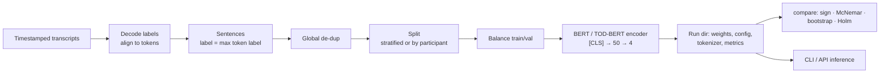

# confusion-bert

[](https://github.com/anushreedas/confusion-detection-bert/actions/workflows/ci.yml)


Sentence-level detection of **four levels of human confusion** (not / slightly / very / extremely confused) from
transcribed speech, by fine-tuning BERT and TOD-BERT, plus a **statistically careful model-comparison harness**.

Originally a graduate capstone (RIT CSCI-739, Spring 2021, notebooks preserved in
[`notebooks/legacy/`](notebooks/legacy/)). This repository re-engineers it into a tested, configurable Python package
with a CLI, an inference API and an optional HTTP service — and documents, honestly, where the original analysis was
weaker than it looked ([`docs/METHODOLOGY.md`](docs/METHODOLOGY.md)).

## What is verified here, and what is not

| Claim | Status |
|---|---|
| Data pipeline, splitting, training loop, inference, API, CLI, significance tests behave as specified | **Verified by the test suite** (`make check`: ruff, mypy, pytest on Python 3.10–3.12 in CI) using a tiny BERT built offline in the tests |
| Label-to-token alignment equals the original notebook's algorithm | **Verified**: property test against a verbatim copy of the 2021 logic on random inputs |
| Accuracies in the table below | **Reported by the 2021 study, not reproduced here.** The transcripts and the course-provided label decoder are not distributed, so this repo cannot regenerate them. See caveats |
| Docker image | Dockerfile + CI build job provided; the service itself is tested via `TestClient` and a live `uvicorn` run on a toy model, not on real weights |

If you have the data and decoder, `make prepare sweep compare` reproduces the whole study end to end (below).

## Reported results (original 2021 study)

Mean accuracy over 20 stratified random subsamples (30% each) of the test set; one training run per configuration.
Full table with min/max: [`results/reported_2021.csv`](results/reported_2021.csv).

| Model | Layers | Mean acc. |
|---|---|---|
| bert-base-uncased | 2 / 6 / 12 / 14 / 18 | 0.762 / **0.817** / 0.800 / 0.808 / 0.797 |
| TOD-BERT-JNT-V1 | 2 / 6 / 12 / 14 / 18 | 0.764 / 0.800 / 0.790 / 0.789 / 0.792 |
| bert-base-uncased, encoder fully frozen | 12 | 0.305 (≈ chance) |
| bert-base-uncased, first 6 layers frozen | 12 | 0.814 |

**How to read these numbers.**

* Accuracy was measured on the *natural, imbalanced* test distribution (only train/val were balanced), and macro-F1 was
  not reported. This repo reports macro-F1 and per-class metrics.
* The 20 subsamples come from one test set and overlap, so the sign-test p-values in the original report are optimistic
  (20/20 wins always yields p = 0.5²⁰ ≈ 9.5·10⁻⁷). Differences of one or two points between configurations are within
  plausible seed variance.
* "14 / 18 layers" means 2 / 6 **randomly initialised** layers added on top of the 12 pretrained ones; "2 / 6 layers"
  truncates the pretrained stack.
* The splits were random at sentence level, so utterances from the same speaker can appear in train and test.
  `data.split_strategy: group` holds out whole participants for a speaker-independent estimate.

## Quick start

```bash
pip install -e ".[dev]"          # CPU PyTorch is fine; see CI for the exact install
make check                       # lint + types + tests

# Train on your own data (see data/README.md for the expected layout)
confusion-bert prepare --config configs/base.yaml
confusion-bert train   --config configs/base.yaml --set model.num_layers=6
confusion-bert predict --run-dir runs/bert-base-uncased_L6 --text "I don't understand what this means"
```

Everything is configured by YAML plus `--set section.key=value` overrides; unknown keys raise instead of being ignored.

### Reproduce the study

```bash
confusion-bert prepare --config configs/base.yaml
confusion-bert sweep   --config configs/base.yaml --experiments configs/experiments.yaml   # 12 configurations
confusion-bert compare --config configs/base.yaml --metric macro_f1 \
    --runs runs/bert-base-uncased_2 runs/bert-base-uncased_6 runs/bert-base-uncased_12
```

`compare` prints, for every ordered pair of models: the original **sign test** over stratified subsamples, an **exact
McNemar test** and a **paired-bootstrap CI** on the full test set, and **Holm-adjusted** p-values.

Label decoding needs the course-provided `base85.time16_decode` module, which is not on PyPI. Point
`data.label_decoder` at your own `module:callable` if you do not have it ([`data/README.md`](data/README.md)).

### Serve a trained model

```bash
pip install -e ".[serve]"
CONFUSION_BERT_RUN_DIR=runs/bert-base-uncased_L6 uvicorn confusion_bert.serving.app:app_factory --factory
curl -X POST localhost:8000/predict -H 'content-type: application/json' -d '{"texts": ["um what does that mean"]}'
```

or `docker build -t confusion-bert . && docker run -p 8000:8000 -v $PWD/runs/<run>:/models/run confusion-bert`.
Inputs are validated (1–64 texts, ≤ 2000 characters each).

## Design



```
src/confusion_bert/
  config.py            typed, validated configs + CLI overrides
  data/                labels · sentences · splits · torch dataset (dynamic padding)
  models/classifier.py encoder + head, layer truncation/extension, freeze policies
  training/trainer.py  AdamW + warm-up, per-epoch validation, best-epoch checkpoint
  evaluation/          metrics · significance tests · split prediction
  inference.py         ConfusionPredictor (loads a run dir, works offline)
  serving/app.py       FastAPI service
  cli.py               prepare | train | evaluate | predict | compare | sweep
tests/                 unit, property, end-to-end and API tests (no network, no GPU)
configs/               base.yaml + the 12 study configurations
docs/                  METHODOLOGY.md · MODEL_CARD.md · original 2021 report (PDF)
```

Each run directory is self-contained and reproducible: `config.yaml`, `model.pt`, `tokenizer/`, `encoder_config/`,
`history.csv`, `train_summary.json`, and after evaluation `predictions_test.csv` / `metrics_test.json`.

## Engineering notes

* **Bugs fixed relative to the notebooks** — including a duplicate-sentence merge that corrupted text and labels — each
  with a regression test; see the table in [`docs/METHODOLOGY.md`](docs/METHODOLOGY.md).
* **Leakage guard**: `prepare` fails if any sentence appears in more than one split.
* **Reproducibility**: seeded splits, subsamples, shuffling and initialisation; deterministic file order.
  GPU kernels are not forced to be bit-exact.
* **Model selection** defaults to best validation macro-F1 (the original kept the last epoch; `train.select: last`
  restores that).

## Limitations

Small, subjective, self-annotated data from ~20 speakers; random-split numbers likely overstate speaker-independent
performance; the original configuration ranking was selected on the test set. Not for decisions about individuals —
see [`docs/MODEL_CARD.md`](docs/MODEL_CARD.md). No trained weights are distributed.

## Credits

* Data: collected in earlier studies — N. Kaushik, R. J. Bailey, A. G. Ororbia, C. O. Alm, *Elicitation of confusion in
  online conversational tasks*, Interspeech 2021; and C. Mince, S. Rhomberg, R. J. Bailey, A. G. Ororbia, C. O. Alm,
  *Developing a Confusion-Detecting Intelligent Cognitive Agent*. Not redistributed here.
* Models: Devlin et al., *BERT* (2019); Wu et al., *TOD-BERT* (EMNLP 2020).
* Significance testing: Dror et al., *The Hitchhiker's Guide to Testing Statistical Significance in NLP* (ACL 2018).

## Author

**Anushree Das** · [LinkedIn](https://linkedin.com/in/anushree-s-das) · [GitHub](https://github.com/anushreedas) ·
[Medium](https://anushree-das.medium.com)

Code is MIT-licensed. The label table and any participant-derived data are excluded from that licence
([`data/README.md`](data/README.md)).
